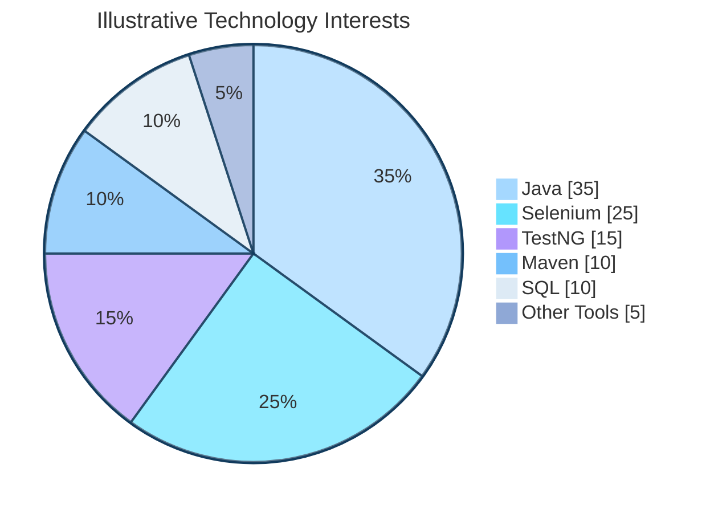

```mermaid
%%{init: {'theme':'base','themeVariables':{'primaryColor':'#123B5D','primaryTextColor':'#F8FCFF','primaryBorderColor':'#74C0FC','lineColor':'#66E3FF','fontFamily':'Segoe UI'}}}%%
flowchart LR
    A([📝 Test data in Excel]) --> B([🔌 Apache POI])
    B --> C([🌐 Selenium WebDriver])
    C --> D([🧪 TestNG])
    D --> E([🎧 Custom listener])
    E --> F([📈 HTML and XML reports])
    style A fill:#A5D8FF,stroke:#123B5D,color:#123B5D
    style B fill:#66E3FF,stroke:#123B5D,color:#123B5D
    style C fill:#74C0FC,stroke:#123B5D,color:#123B5D
    style D fill:#B197FC,stroke:#123B5D,color:#123B5D
    style E fill:#DDEAF5,stroke:#123B5D,color:#123B5D
    style F fill:#F8FCFF,stroke:#123B5D,color:#123B5D
```
 

**[🏰 Story](#-the-story-of-yogeshwari)** •
**[🧊 Powers](#-my-magical-technical-powers)** •
**[🏦 Projects](#-project-kingdom)** •
**[👑 Characters](#-the-frozen-character-kingdom)** •
**[🎵 Music](#-let-it-go-let-it-code)** •
**[📊 Stats](#-the-magical-data-kingdom)** •
**[🏆 Goals](#-achievements-and-goals)** •
**[📬 Connect](#-connect-with-me)**

<h2 align="center">🏰 The Story of Yogeshwari</h2>

<table>
<tr>
<td width="38%" align="center" valign="middle">
  
</td>
<td width="62%" valign="top">

> *Once upon a time, in a kingdom where every click could hide a bug, a curious tester picked up Java and Selenium, and began turning repetitive checks into reliable, magical automation.* ❄️

- 🔎 Passionate about **Software Testing and Quality Assurance**
- ☕ Interested in **Java-based Selenium automation**
- 🧪 Experience working with **TestNG and Maven**
- 📊 Interested in **Data-Driven Testing** using **Excel and Apache POI**
- 🏗️ Building and improving **web automation frameworks**
- 🐛 Interested in **identifying defects** and improving application quality
- 🌱 **Continuously learning** new automation technologies

</td>
</tr>
</table>

<h2 align="center">🧊 My Magical Technical Powers</h2>

<table>
<tr>
<td width="50%" valign="top" align="center">

### ☕ Programming

### 🤖 Automation

</td>
<td width="50%" valign="top" align="center">

### 🧪 Testing

### 🛠️ Tools

</td>
</tr>
</table>

<h2 align="center">🏦 Project Kingdom</h2>

<i>Two magical creations, built with Java, Selenium and TestNG.</i>

<table>
<tr>
<td width="50%" valign="top">

### 🏦 Bank Application Automation: Parabank

A **Selenium-based automation testing framework** for the **Parabank** web application, with Excel-driven test data.

**Tech stack:** `Java` `Selenium WebDriver` `TestNG` `Maven` `Apache POI` `Excel-based DDT` `Eclipse IDE`

**Major capabilities**
- 🌐 Browser automation using Selenium WebDriver
- 🧪 Test execution using TestNG
- 📊 Excel-based test data management
- 🔌 Apache POI integration
- ♻️ Reusable automation components
- 📦 Maven dependency management
- 📈 TestNG HTML and XML reports

</td>
<td width="50%" valign="top">

### 🛍️ E-Commerce Test Automation Framework

Automates **end-to-end e-commerce user journeys** using Selenium WebDriver, Java, TestNG and Maven. The repository includes **16 test classes** covering major shopping scenarios.

**Tech stack:** `Java` `Selenium WebDriver` `TestNG` `Maven` `Eclipse IDE`

**Functional areas**
- 🔐 **Authentication and Account:** registration, login, logout
- 🔎 **Product Discovery:** search, categories, product listings, recommended items
- 🛒 **Cart and Checkout:** add and remove products, verify cart contents, validate quantities, place orders
- ⭐ **Engagement and Subscription:** product reviews, contact us, subscription verification, cart page subscription

**Framework components:** custom TestNG listener, shared functionality, Maven configuration, TestNG HTML and XML reports

</td>
</tr>
</table>

<h2 align="center">👑 The Frozen Character Kingdom</h2>

<i>Five friends, five testing superpowers. Illustrations are original winter-themed art inspired by the spirit of each friend.</i>

<table>
<tr>
<td align="center" width="33%"></td>
<td align="center" width="33%"></td>
<td align="center" width="33%"></td>
</tr>
</table>
<table>
<tr>
<td align="center" width="33%"></td>
<td align="center" width="33%"></td>
</tr>
</table>

<h2 align="center">✨ Magical Effects</h2>

❄️ Falling snow · 🌌 shifting aurora · 💎 pulsing ice crystals · 🏰 glowing castle windows · 🌊 flowing frozen waterfalls ❄️

<h2 align="center">🎵 Let It Go... Let It Code!</h2>

 

🎧 Nothing autoplays. Click a badge to listen on your favourite platform.

<h2 align="center">📊 The Magical Data Kingdom</h2>

 

 

📌 All numbers above are fetched live from GitHub by the services, nothing is hand-written.

<h2 align="center">🥧 Magical Technology Interests</h2>

⚠️ Illustrative technology interests, not actual GitHub language statistics.

<b>❄️ View the Mermaid version of the chart</b>

<h2 align="center">🌌 My Contribution Journey</h2>

<b><i>Every Contribution Adds Another Snowflake to My Kingdom.</i></b>

<h2 align="center">🏆 Achievements and Goals</h2>

<table>
<tr>
<td width="50%" valign="top">

### ✅ Treasures Already Won
- ❄️ Building **Selenium automation frameworks**
- ❄️ Creating **reusable test components**
- ❄️ Automating **banking application** scenarios
- ❄️ Automating **e-commerce user journeys**

</td>
<td width="50%" valign="top">

### 🌟 Quests in Progress
- ✨ Learning **advanced Java**
- ✨ Improving **test coverage**
- ✨ Exploring **CI/CD**
- ✨ Learning **advanced automation architecture**

</td>
</tr>
</table>

<h2 align="center">📬 Connect With Me</h2>

✏️ Replace the LinkedIn and email placeholders with your real details.

  

**Made with ❤️, Java ☕, Selenium 🌐 and a little Frozen magic ❄️**

This profile is a fan-made tribute inspired by the winter-fantasy mood of Disney's Frozen. It is not affiliated with or endorsed by Disney. All artwork in this repository is original.

